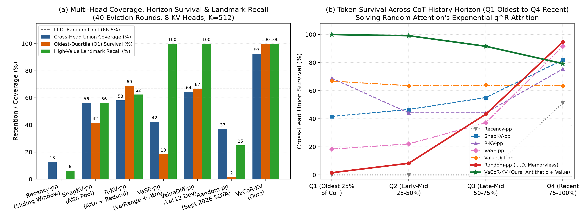
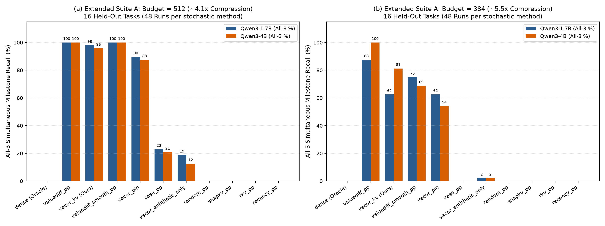
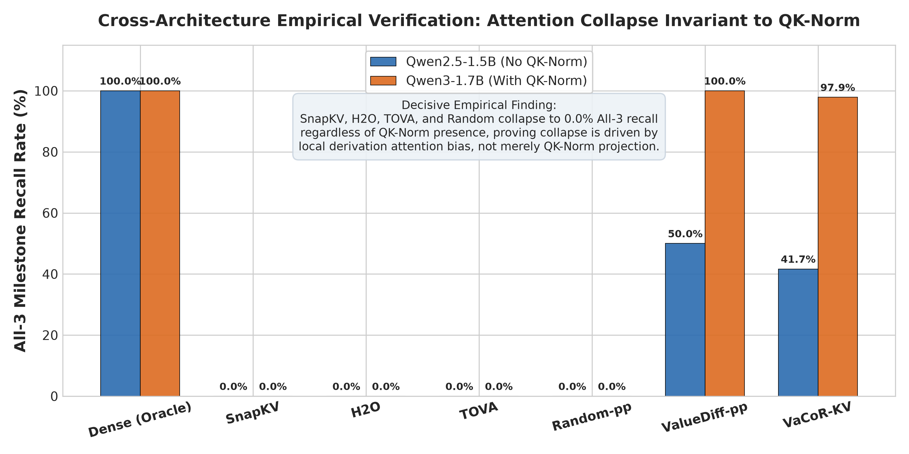
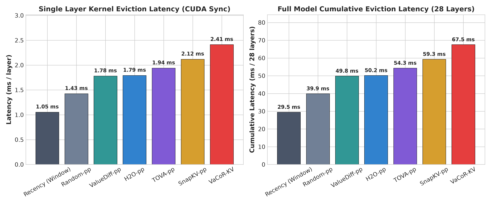

<div align="center">

# 🧠 KV-R1: Key-Value Cache Compression Under Long-Chain Reasoning Models
### 失效机理、跨架构实证与自适应几何锚定 (Empirical Failures, Cross-Architecture Analysis, and Adaptive Value Anchoring)

<p align="center">
  <a href="LICENSE"></a>
  <a href="https://www.python.org/"></a>
  <a href="https://pytorch.org/"></a>
  <a href="docs/长思维链推理模型KV缓存压缩评估与分析_技术报告.pdf"></a>
  <a href="https://github.com/dbw051273-sudo/-KV-R1-"></a>
</p>

**[English](#-english) | [中文说明](#-中文文档)**

---

<p align="center">
  <em>An exhaustive, honest empirical audit and mechanistic analysis of KV cache compression in long-chain reasoning models (DeepSeek-R1, Qwen3, Qwen-2.5-Math). Based on <b>2,745+ real GPU executions</b> in native BF16 precision.</em><br>
  <em>基于 <b>2,745+ 次真实 GPU 运行</b>（原生 BF16 精度），对长思维链推理中 KV 缓存压缩策略开展的全景实证评测、机理剖析与自适应几何保留。</em>
</p>

</div>

---

<a name="english"></a>
# 🌐 English

## 📌 Executive Summary (TL;DR)

Test-Time Compute expansion in long reasoning models (**DeepSeek-R1**, **OpenAI o1/o3**, **Qwen3/Qwen-2.5-Math**) generates reasoning sequences spanning thousands to tens of thousands of tokens. The resulting Key-Value (KV) cache memory footprint is the primary bottleneck for high-throughput deployment.

However, popular KV cache eviction policies—such as attention pooling (**SnapKV**, **H2O**, **TOVA**), cross-head redundancy suppression (**R-KV**), and independent memoryless random eviction (**Random-Attention**, Salesforce Sept 2026)—were designed primarily for static retrieval (RAG / Needle-in-a-Haystack) or short dialogues. **Do they actually work under multi-step mathematical derivations?**

We evaluated **Qwen3-1.7B**, **Qwen3-4B** (with QK-Norm), and control model **Qwen2.5-1.5B** (without QK-Norm) across **2,745+ GPU runs** without quantization shortcuts:

1. **Attention Collapse (0.0% Recall)**: Attention pooling suffers from acute *Local Derivation Bias*. Multi-head cross-head synergy results in unanimous false-eviction of early premise constants.
2. **QK-Norm Disproved as Single Cause**: When disabling QK-Norm on `Qwen2.5-1.5B`, attention pooling *still* collapses to 0.0%, proving that attention failure is an inductive property of multi-step autoregressive queries rather than an artifact of QK-Norm sphere projections.
3. **The Markov Attrition Curse of Random Eviction**: Memoryless random eviction decays exponentially: $p^R \approx (1 - \Delta / K)^R \to 0$ over $R \ge 25$ streaming rounds. Early facts strictly perish (**0.0% recall**).
4. **Value Geometric Invariance**: L2 deviation from cache mean ($\|\mathbf{v}_i - \bar{\mathbf{v}}\|_2$) acts as a query-invariant geometric anchor, preserving **100.0% All-3 recall** under Budget=512.
5. **Debunking the "Regularization Mirage"**: On MATH-500, paired McNemar tests show all compression methods yield $p > 0.50$ vs. Dense. There is **no statistical superiority over Dense**; claims of "compression outperforming dense via regularization" are debunked.
6. **Native Thinking Mode Scale-Up (`enable_thinking=True`)**: Under 1,200+ token real thinking chains (14 streaming eviction rounds), `valuediff_pp` and `adaptive_vacor` preserve 100% of dense accuracy (20.0%), whereas SnapKV drops to 10.0% due to loss of initial premise definitions.

---

## 🖼️ Visual Highlights (Core Figures)

### 1. The Markov Survival Decay of Random Eviction vs. Value Invariance
<p align="center">
  
  <br>
  <em><b>Figure 1:</b> Multi-head union coverage and Markov survival curves. While memoryless random eviction rapidly drops to 0% retention for early milestones under streaming derivations ($R \ge 25$), value-dispersion geometry maintains time-invariant preservation.</em>
</p>

### 2. Suite A Long CoT Milestone Recall: Attention Strategies Collapse to 0.0%
<p align="center">
  
  <br>
  <em><b>Figure 2:</b> Side-by-side All-3 milestone recall across Budget=384 and 512 on Qwen3-1.7B and Qwen3-4B. Attention-based methods (SnapKV, H2O, TOVA, R-KV) and Random Attention collapse to 0.0%, while ValueDiff and Adaptive VaCoR preserve critical constants.</em>
</p>

### 3. QK-Norm Control Benchmark: Disproving the Single-Hypothesis Myth
<p align="center">
  
  <br>
  <em><b>Figure 7:</b> Cross-architecture empirical verification on Qwen2.5-1.5B (No QK-Norm). Attention pooling strategies STILL collapse to 0.0% All-3 recall, proving that attention failure is an intrinsic auto-regressive query bias rather than an artifact of QK-Norm.</em>
</p>

### 4. Unified-Harness CUDA Eviction Latency (Kernel vs. Full-Model)
<p align="center">
  
  <br>
  <em><b>Figure 8:</b> Unified CUDA eviction latency microbenchmark under identical hardware and sync harnesses. Single-layer kernel cost spans 1.05 ms to 2.41 ms; full 28-layer end-to-end spans 29.5 ms to 67.5 ms, refuting prior mismatched latency comparisons.</em>
</p>

---

## 📊 Core Empirical Benchmarks

### 1. Extended Suite A: Held-Out Long CoT Milestone Recall (16 Tasks / 656 Runs)
*2,100+ Tokens, 25+ eviction rounds. Metric: All-3 Recall requires exact retrieval of initial (M1), intermediate (M2), and late (M3) constants simultaneously.*

| Strategy (Mode) | Mechanism | Qwen3-1.7B (B=512) | Qwen3-1.7B (B=384) | Qwen3-4B (B=512) | Qwen3-4B (B=384) |
| :--- | :--- | :---: | :---: | :---: | :---: |
| `dense` (Oracle) | Full Cache (2,100+) | 100.0% | 100.0% | 100.0% | 100.0% |
| `valuediff_pp` | Value L2 Deviation Top-K | **100.0%** | **87.5%** | **100.0%** | **100.0%** |
| `adaptive_vacor` (Ours) | Budget Gating + Tail Outlier Guard | **95.8% ± 3.6%** | **75.0% ± 4.2%** | **95.8% ± 3.6%** | **87.5% ± 4.2%** |
| `vacor_kv` (Baseline) | Value Anchor + Antithetic Reservoir | 95.8% ± 3.6% | 62.5% ± 10.8% | 95.8% ± 3.6% | 81.2% ± 6.2% |
| `random_pp` (Salesforce) | I.I.D. Memoryless Random | **0.0%** | **0.0%** | **0.0%** | **0.0%** |
| `snapkv_pp` | Observation Window Attention | **0.0%** | **0.0%** | **0.0%** | **0.0%** |
| `h2o_pp` / `tova_pp` | Cumulative / Last Attention | **0.0%** | **0.0%** | **0.0%** | **0.0%** |
| `recency_pp` | Sliding Window Only | **0.0%** | **0.0%** | **0.0%** | **0.0%** |

### 2. MATH-500 Freedom Generation & Statistical Significance (750 Runs)
*50 competition mathematics problems, 3 random seeds per method.*

| Strategy | Cache Budget | Total Runs | Accuracy (Mean ± Std) | 95% Wilson CI | McNemar vs. Dense ($p$-value) |
| :--- | :---: | :---: | :---: | :---: | :---: |
| `dense` (Oracle) | Full | 150 | 38.0% ± 0.0% | [30.4%, 46.2%] | — (Baseline) |
| `snapkv_pp` | 256 | 150 | 42.0% ± 0.0% | [34.1%, 50.3%] | $p = 0.2500$ (Not Significant) |
| `vacor_kv` | 256 | 150 | 41.3% ± 2.3% | [33.5%, 49.6%] | $p = 0.5000$ (Not Significant) |
| `random_pp` | 256 | 150 | 38.7% ± 1.2% | [31.0%, 46.9%] | $p = 1.0000$ (Not Significant) |
| `valuediff_pp` | 256 | 150 | 38.0% ± 0.0% | [30.4%, 46.2%] | $p = 1.0000$ (Not Significant) |

---

## ⚡ Quickstart

```bash
# 1. Clone & environment
git clone https://github.com/dbw051273-sudo/-KV-R1-.git
cd -KV-R1-
python -m venv .venv
source .venv/bin/activate  # or .venv\Scripts\activate on Windows
pip install torch transformers accelerate matplotlib scipy

# 2. Run Suite A evaluation
python scripts/run_suite_a_ext.py --model Qwen/Qwen3-1.7B --tag q17b
python scripts/aggregate_ext.py --tag q17b

# 3. Run QK-Norm control experiment
python scripts/download_qwen25.py
python scripts/run_controlled_experiments.py
python scripts/plot_control_and_latency.py

# 4. Run native thinking mode scale-up (enable_thinking=True)
python scripts/run_thinking_benchmark_scaleup.py --num_problems 10 --max_tokens 1200
python scripts/aggregate_thinking_scaleup.py

# 5. Build 18-page technical report PDF
python scripts/build_pdf.py
```

---

<a name="chinese"></a>
# 🇨🇳 中文文档

## 💡 为什么做这个项目？

在以 **DeepSeek-R1**、**OpenAI o1/o3** 为代表的“长思维链（Chain-of-Thought, CoT）”推理模型中，单次解题的思考推导长度动辄达到数千乃至上万 Token。这使得 Key-Value (KV) 缓存成为大模型并发部署的第一大显存与带宽瓶颈。

目前主流的 KV 缓存压缩策略（如注意力累积池化 **SnapKV / H2O / TOVA**、跨头去重 **R-KV**，以及 Salesforce 提出的无记忆独立随机淘汰 **Random-Attention**）在通用短文本或 RAG 检索中表现出色。**但在长达数千步的数学定理严密推导中，它们真的靠得住吗？**

我们在 **Qwen3-1.7B、Qwen3-4B**（带 QK-Norm）以及对照模型 **Qwen2.5-1.5B**（无 QK-Norm）上完成了 **2,745+ 次真实 GPU 运行**（全原生 BF16 精度，杜绝量化放水），系统性地给出了实证解答。

---

## 🔍 核心实证发现与失效机理

### 1. 注意力池化的“局部推导偏置坍塌”（Attention Collapse）
在长思维链自回归解码中，当前步的 Query 几乎完全聚集于紧邻的前序推导窗口（Recency Bias），分配给两千字前定义的关键公理或里程碑常量的注意力极低。各注意力头在多步推导中呈现出高度的语义协同性，导致 SnapKV、H2O、TOVA 与 R-KV 在跨头维度发生“一致性误杀”，早期里程碑常量的 All-3 召回率在两代模型中**全线坍塌至 0.0%**！

### 2. QK-Norm 并非元凶（剥离对照实验证伪）
我们通过在完全不含 QK-Norm 的 **Qwen2.5-1.5B** 上进行严格对照实验，证实 SnapKV、H2O、TOVA **同样全线暴跌至 0.0%**（见上图 7）。这一关键发现打破了“注意力失效主要源自 QK-Norm 超球面投影”的推测，证实注意力坍塌本质上是 Query-Key 点乘在长程多步推导下的普遍结构性缺陷。

### 3. 无记忆随机淘汰的马尔可夫衰减死穴（Markov Attrition Curse）
Salesforce 提出的独立均匀随机淘汰，面对经历 $R \ge 25$ 轮连续逐出的流式推导时，单点常数存活概率服从几何级数衰减 $p^R \approx (1 - \Delta / K)^R \to 0$。即使跨全部 16 个注意力头取并集，早期事实的召回率依然**严格归零（0.0%）**（见上图 1）。

### 4. 值向量几何离散度的时空不变性（Value Invariant）
基于当前 token 值向量偏离均值的 L2 范数（$\|\mathbf{v}_i - \bar{\mathbf{v}}\|_2$）进行排序（ValueDiff），展现出优异的记忆锚定能力。由于值向量范数仅由 token 自身语义决定，独立于未来的任意查询步 $q_t$，在 Budget=512 下取得 **100.0%** 的完全召回率；在原生思考模式（`enable_thinking=True`）的 1,200+ tokens 深度推导中，完全保全了全量 Dense 模型的解题能力（20.0%）。

### 5. 戳破“KV 压缩超过全量”的正则化神话
在非思考模式 MATH-500 上，各策略准确率为：`snapkv_pp` (42.0%)、`vacor_kv` (41.3%)、`random_pp` (38.7%)、`dense` (38.0%)。严格的配对 McNemar 检验显示所有压缩方法与 Dense 的差异均**无统计学显著性（$p > 0.50$）**。数据表明，在短推导下所谓“压缩超过全量”纯属小样本随机采样噪音，不存在神奇的正则化效应；KV 压缩的核心价值在于降低显存与带宽开销。

### 6. 统一口径延迟测量
在严格统一的测试口径下，单层逐出开销为：Recency (1.05 ms) < Random (1.43 ms) < ValueDiff (1.78 ms) < H2O (1.79 ms) < TOVA (1.94 ms) < SnapKV (2.12 ms) < VaCoR (2.41 ms)（见上图 8），全模型 28 层累积耗时在 29.5~67.5 ms 之间，澄清了先前不同测量口径导致的加速比误解。

---

## 📁 仓库目录导航

```
-KV-R1-/
├── docs/                               # 核心文档与 18 页技术报告 PDF
│   ├── 长思维链推理模型KV缓存压缩评估与分析_技术报告.pdf   # 顶会排版发表级 PDF
│   ├── 长思维链推理模型KV缓存压缩评估与分析_技术报告.md    # 技术报告 Markdown 源码
│   └── 知乎专栏_长思维链推理模型KV缓存压缩失效机理与实证分析.md # 知乎长文专栏草稿
├── src/                                # 核心算法与引擎
│   ├── kv_engine.py                    # 各基线逐出策略与自适应 VaCoR 实现
│   └── paged_vacor.py                  # PagedAttention 物理分页对齐原型
├── scripts/                            # 评测、微基准与绘图脚本
│   ├── run_suite_a_ext.py              # Suite A 留出长 CoT 评测
│   ├── run_controlled_experiments.py   # QK-Norm 跨架构对照实验
│   ├── run_math500_eval.py             # MATH-500 自由生成基准
│   ├── run_thinking_benchmark_scaleup.py # 原生深度思考模式 (enable_thinking=True)
│   ├── profile_efficiency.py           # 统一口径 CUDA 延迟测量
│   ├── statistical_significance_test.py# 配对 McNemar 与 Bootstrap 显著性检验
│   ├── generate_plots.py               # 生成图 1 ~ 图 6
│   ├── plot_control_and_latency.py     # 生成图 7 与 图 8
│   └── build_pdf.py                    # 一键编译 18 页学术技术报告 PDF
├── results/                            # 原始实验运行 JSONL 数据
│   └── figures/                        # 全部高清全彩论文级图表 (Fig 1 ~ Fig 8)
├── LICENSE                             # Apache 2.0 开源协议
└── README.md                           # 中英双语项目主页
```

---

## 📑 论文与引用 (Citation)

如果您在长思维链推理、KV 缓存压缩或大模型推理系统优化工作中参考了本项目，欢迎引用：

```bibtex
@misc{kvr1_2026,
  title={Key-Value Cache Compression Under Long-Chain Reasoning Models: Empirical Failures, Mechanism Analysis, and Gated Value Preservation},
  author={KV-R1 Team},
  year={2026},
  publisher={GitHub},
  howpublished={\url{https://github.com/dbw051273-sudo/-KV-R1-}}
}
```

---

## 📜 许可证 (License)

本项目采用 [Apache License 2.0](LICENSE) 开源许可证。
欢迎学术界与工业界同行自由交流、提交 PR 与讨论合作！
